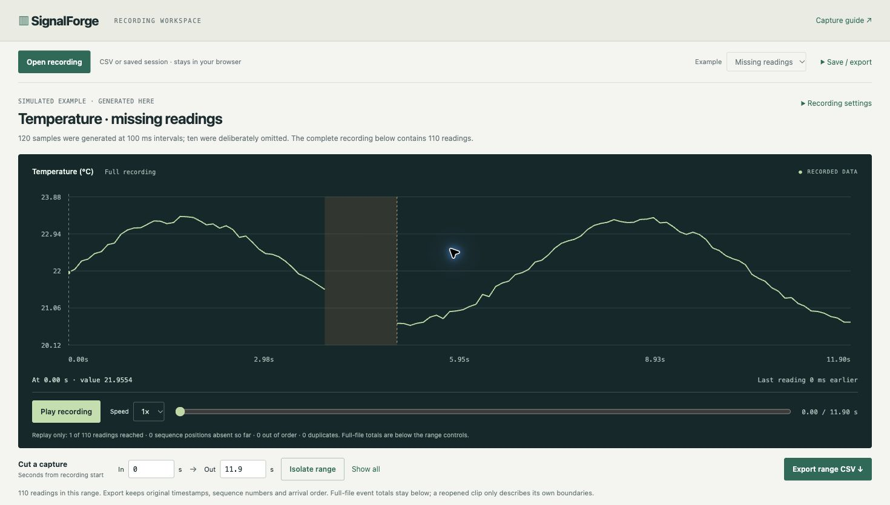

# SignalForge

**Find where a sensor recording has missing readings, late arrivals or duplicate sequence numbers.** Open a CSV, navigate its timeline, isolate a time range, and export the surrounding readings. All file processing happens in your browser.

[Open recording workspace](https://aaltahms.github.io/signal-forge/) · [Engineering portfolio](https://aaltahms.github.io/)

A specific use: you are testing a microcontroller logger that should deliver one temperature reading every 100 ms. Its plot has a hole. SignalForge shows the two arrival timestamps, the sequence positions skipped, whether any readings arrived later, and the exact rows supporting that finding. You can save the capture and findings for a bug report.

The included example generates 120 samples and omits sequences 40–49. The resulting file has 110 readings, ten sequence positions absent at the end, and a 1,100 ms pause between the last reading before the omission and the first one after it. A second example recovers a delayed reading and separately detects a duplicate. These are **simulated examples**, not measurements from a physical sensor.



## Try it

No account, package installation, API key, or local backend is needed for the hosted app. Open your CSV or a saved SignalForge session. The first screen includes a complete example, a visible gap, and its evidence; no dashboard configuration is needed.

1. Use **Open recording** for a CSV or saved session. The Example selector opens clearly simulated recordings.
2. Play or seek through the signal timeline. Select an event marker to jump to its arrival time.
3. Choose **Isolate this event**, or enter In/Out seconds and choose **Isolate range**. The chart fits that range; full-file event totals remain separately labeled.
4. **Export range CSV** saves only readings inside the inclusive time bounds, keeping original collector timestamps, boot labels, sequence numbers and arrival order. A range with no received readings is rejected. Reopening a clip assesses its own boundaries, not the original complete recording.
5. Use **Save / export** for the complete session, complete CSV, or findings text. Reopening a session recalculates its findings from the included inputs and settings.

## Use your own recording

```csv
received_ms,sequence,value,boot_id
0,0,22.4,boot-1
100,1,22.6,boot-1
400,4,22.8,boot-1
```

- `received_ms`: collector arrival time in milliseconds, in nondecreasing order. Elapsed time is recommended. Do not sort the rows by sequence or use an unsynchronized device clock as arrival time.
- `sequence`: unsigned 32-bit counter incremented once per produced sample. Wraparound is supported. A reset needs a new boot label.
- `value`: one finite numeric signal. Use one signal per file and your own units; imports are labeled as recorded values.
- `boot_id`: optional, defaults to `capture`; 1–64 letters, digits, dots, underscores or hyphens. Each boot occupies one contiguous segment; an earlier label cannot be reused after a different boot.

Columns may be reordered. Quoted fields, CRLF, a UTF-8 BOM and blank lines are supported. Unsupported columns and malformed rows produce actionable errors while keeping the prior recording visible. Limits: **20,000 readings, CSV up to 2 MiB, saved JSON session up to 8 MiB**. The app never uploads files, stores them remotely, or calls an AI service. Downloaded reports contain your data; review them before sharing.

Set the expected interval to match your device. The default timing-gap rule is **strictly greater than three expected intervals**. Sequence continuity is checked independently. The first and last observed sequence establish the capture boundary; absent samples before or after the file cannot be inferred.

## Capture a stream with Python

Python 3.9+; standard library only. Send one JSON object per line:

```json
{"sequence": 0, "value": 22.4, "boot_id": "boot-1"}
```

Capture a pipeline on stdin:

```sh
python3 -m collector.capture --output capture.csv
```

For a local POSIX serial device, use its actual device path:

```sh
python3 -m collector.capture --device /dev/cu.YOUR_DEVICE \
  --baud 115200 --count 1000 --output capture.csv
```

Direct serial capture supports macOS/Linux. Stdin capture is also available elsewhere. The adapter reads the JSON protocol above, stamps each complete reading using the collector's monotonic clock, rejects malformed frames with diagnostic messages, and restores serial settings on exit. It does not write device commands. A serial port may reset a connected board when opened; board/driver behavior must be validated with that hardware. The default serial idle timeout is 10 seconds; `--idle-seconds` changes it. Existing output files are never overwritten. Interrupting capture retains completed rows.

For a clearly simulated producer through the actual capture CLI:

```sh
python3 examples/producer.py --count 30 --interval-ms 100 | \
  python3 -m collector.capture --count 30 --output simulated-capture.csv
```

Open the resulting CSV in the app. This exercises real stream framing and collector timestamps with simulated values. Virtual serial tests exercise a pseudo-terminal; **no physical device has been validated in this release**.

## Local development and verification

```sh
python3 -m http.server 4180 --bind 127.0.0.1 --directory web
```

Open http://127.0.0.1:4180. Node 22+ is needed only for checks:

```sh
node --check web/app.mjs
node --test tests/analysis.test.mjs
python3 -B -m unittest discover -s tests -p 'test_*.py' -v
```

The release has 23 JavaScript checks and ten Python checks. Meaningful cases include wraparound, a billion-position gap without allocating missing samples, reboot segmentation, late recovery, duplicate payload differences, prefix replay consistency, an independent set-based oracle over 80 seeded captures, CSV/session round trips including the 20,000-row boundary, bounded framing, virtual serial I/O, idle timeout, tty restoration, and actual producer-to-capture command-line integration. The CI workflow targets Ubuntu; local checks run on macOS. Browser checks cover import, error recovery, replay, export/reopen and a narrow viewport. This is functionality verification, not a user study or physical-device certification.

## Engineering and boundaries

The browser and Node tests share one pure JavaScript detector. The Python collector normalizes input and records arrival timestamps; it does not implement a competing detector. State per boot tracks an extended sequence high-water mark, seen positions and ordered gap intervals. Late recovery uses binary search over intervals; missing positions are counted without enumerating them. Replay stores prefix counters so future arrivals cannot change the past displayed in the player. The complete-file event explanation separately reports later recovery.

A gap is evidence about a **recording**, not proof of network loss or broken hardware. Collector pauses, filtering, dropped messages and producer behavior can look similar. Duplicate detection assumes counters are unique within a boot. Changes to sensor values are not independently diagnosed. The viewer currently supports one numeric channel, this explicit CSV schema and bounded recordings; live browser serial connections, arbitrary vendor log adapters and physical-device evaluation are later milestones.

The research [decision record](docs/research.md) compares this scope with established tools. [Detector contract](docs/method.md) defines the observations and ambiguities. This is an original focused learning/portfolio tool, built by Aymen Al-Tahmschi with Codex assistance. No upstream tool code, screenshots or data are bundled. MIT licensed.
